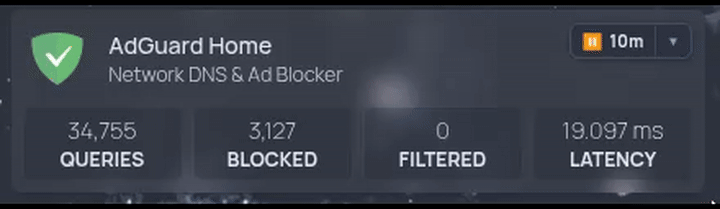

# 🛡️ Homepage AdGuard Home Header Action Pill

> Add an interactive 1-Click Pause & Resume action pill with custom durations and a live ticking countdown directly to your [Homepage](https://gethomepage.dev/) dashboard — **no Home Assistant required!**

<div align="center">
  
</div>

> [!NOTE]
> **Why this exists**: The standard community advice for adding buttons to Homepage is *"just set up Home Assistant and build an automation."* If you only run a lightweight server with a few services, installing and configuring Home Assistant just to pause DNS blocking for 10 minutes is massive overkill. This project gives you a direct, native-feeling toggle with zero external software needed.

---

## ✨ Features

- 🚫 **No Home Assistant Needed**: Completely standalone — built specifically to eliminate the need for an external Home Assistant stack.
- ⚡ **1-Click Default Pause**: Click the badge once to instantly pause AdGuard for 10 minutes.
- ⏱️ **Split Duration Dropdown**: Click the chevron (`▼`) to pick custom durations:
  - ⚡ 30 seconds
  - ⏱️ 1 minute
  - ⏱️ 10 minutes
  - 🕒 1 hour
  - 🌙 *Until tomorrow* (dynamically calculates milliseconds to midnight)
- ⏳ **Live Countdown Timer**: Once paused, the pill turns into a subtle pulsing red indicator showing real-time remaining time (`▶ 09:42`).
- 🛡️ **Click-to-Resume**: Click the ticking badge at any time to immediately cancel the pause and resume DNS protection.
- 🔒 **Zero Extra Ports / No CORS Issues**: Bypasses the AdGuard API's CORS limitations by using Homepage's Next.js backend as a same-origin proxy. Zero firewall modifications needed; works flawlessly over LAN, Tailscale, or HTTPS reverse proxies.
- 🎨 **Nord / Slate Aesthetic**: Translucent frosted glass look with smooth hover effects, dropdown shadows, and toast notifications.

---

## 🏗️ Architecture

AdGuard Home's API (`/control/protection`) returns `405 Method Not Allowed` when called directly from a browser because it does not support CORS preflight (`OPTIONS`) requests. Furthermore, accessing Homepage over HTTPS causes mixed-content blocks when calling HTTP endpoints.

This project solves both problems elegantly by routing status checks and protection toggles through Homepage's existing config API handler (`/api/config/adguard`):

```
┌──────────────────────────────────────┐
│        Browser (Homepage UI)         │
└──────────────────┬───────────────────┘
                   │  GET /api/config/adguard?action=pause&duration=600000
                   │  (Same-origin: No CORS, No mixed-content, No extra port)
                   ▼
┌──────────────────────────────────────┐
│ Homepage Container (:3000)           │
│   Next.js API: /api/config/[path].js │
└──────────────────┬───────────────────┘
                   │  POST http://adguard-host:80/control/protection
                   │  (Server-to-server with Basic Auth)
                   ▼
┌──────────────────────────────────────┐
│         AdGuard Home Server          │
└──────────────────────────────────────┘
```

---

## 🚀 Quick Start

### 1. Add `id: adguard-home` to `services.yaml`

In your Homepage `config/services.yaml`, ensure your AdGuard Home item has `id: adguard-home`:

```yaml
    - AdGuard Home:
        id: adguard-home
        icon: adguard-home.png
        href: http://192.168.1.1:80
        description: Network DNS & Ad Blocker
        widget:
          type: adguard
          url: http://192.168.1.1:80
          username: "{{HOMEPAGE_VAR_ADGUARD_USER}}"
          password: "{{HOMEPAGE_VAR_ADGUARD_PASSWORD}}"
```

### 2. Copy `custom.js` & `custom.css`

Copy the files from the `config/` directory in this repo into your Homepage's `config/` directory:

```bash
cp config/custom.js /path/to/your/homepage/config/custom.js
cp config/custom.css /path/to/your/homepage/config/custom.css
```

### 3. Extract & Patch Container Files

Run the provided patch script inside your Homepage compose directory. It automatically extracts `en.html` and `[path].js` from your running Homepage container and injects the script tag and API proxy handler:

```bash
# Supports docker and podman (syntax: ./patches/patch.sh [container_name])
./patches/patch.sh homepage
```

This creates:
- `en.html.patched` (injects `<script src="/api/config/custom.js" defer></script>`)
- `path.js.patched` (proxies `/api/config/adguard` calls to AdGuard)

### 4. Update `docker-compose.yml`

Mount the two patched files and configure your AdGuard environment variables:

```yaml
services:
  homepage:
    image: ghcr.io/gethomepage/homepage:latest
    container_name: homepage
    ports:
      - "3000:3000"
    volumes:
      - ./config:/app/config:z
      # Mount the patched files
      - ./en.html.patched:/app/.next/server/pages/en.html:z
      - "./path.js.patched:/app/.next/server/pages/api/config/[path].js:z"
      - /var/run/docker.sock:/var/run/docker.sock:ro
    environment:
      - PORT=3000
      - HOMEPAGE_ALLOWED_HOSTS=*
      # AdGuard Home settings for the proxy
      - HOMEPAGE_VAR_ADGUARD_URL=http://192.168.1.1:80
      - HOMEPAGE_VAR_ADGUARD_USER=your_username
      - HOMEPAGE_VAR_ADGUARD_PASSWORD=your_password
    restart: always
```

### 5. Restart Homepage

```bash
docker compose down && docker compose up -d
# or: podman-compose down && podman-compose up -d
```

Hard-refresh your Homepage browser tab (`Ctrl + F5` or `Cmd + Shift + R`). The action pill will appear in the top-right header of your AdGuard Home card!

---

## ⚙️ Customization

In `config/custom.js`, you can easily customize:
- **Default pause time**: Change `DEFAULT_PAUSE_MS = 600000;` (default is 10 minutes).
- **Dropdown durations**: Add, change, or remove options in the `agh-dropdown-menu` HTML block.
- **Polling interval**: Change the status check interval (default: 7 seconds).

In `config/custom.css`, you can adjust colors, fonts, or position to match your personal Homepage theme.

---

## 📄 License

MIT License. See [LICENSE](LICENSE) for details.
